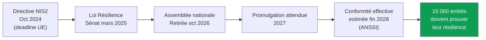
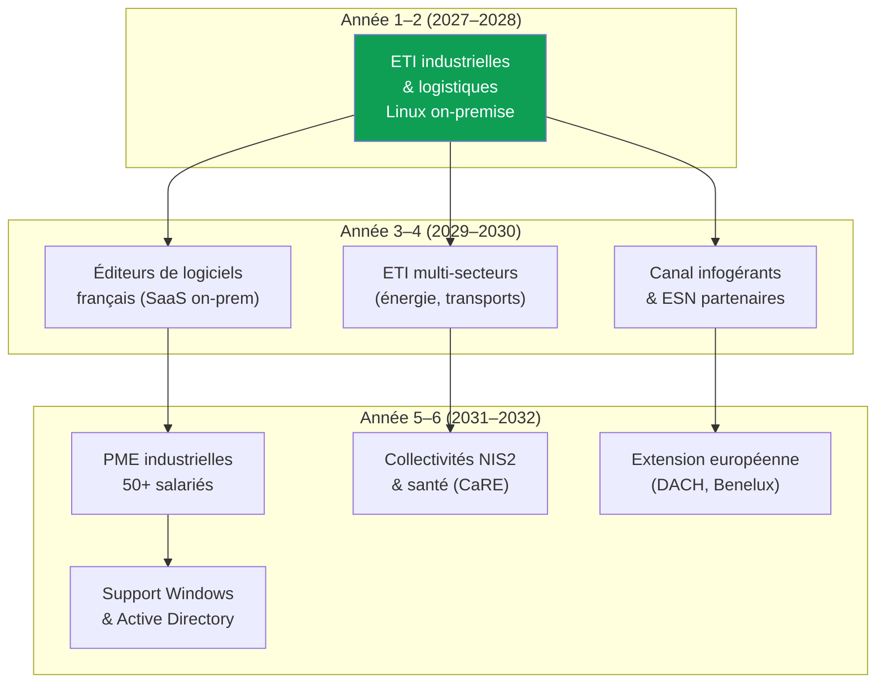
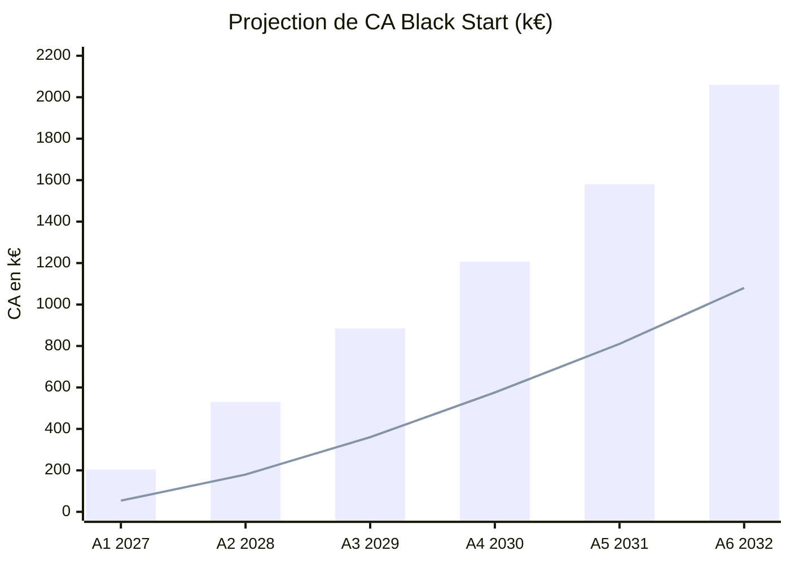
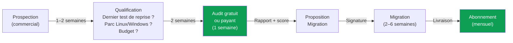

# Analyse de marché — Black Start
## Projection sur 6 ans (2027–2032)

> [!NOTE]
> Ce document compile des données sourcées et des hypothèses de travail clairement identifiées. Les chiffres d'entretien restent à valider. Les hypothèses de pricing et de pénétration sont conservatrices.

---

## 1. Le marché adressable

### 1.1 TAM — Total Addressable Market

Black Start se positionne à l'intersection de trois marchés en forte croissance :

| Marché | Taille (Europe) | CAGR | Source |
|---|---|---|---|
| **Disaster Recovery as a Service** | ~3,4 Md$ → 9,5 Md$ (2030) | 16–18 % | MarketsAndMarkets |
| **Infrastructure as Code** | ~1,5 Md$ → 5–7 Md$ (2030) | 20–25 % | Fortune Business Insights |
| **Cybersécurité France** | ~7,3 Md€ → 11 Md€ (2030) | 7,5–11 % | PAC / InCyber |

**TAM France (sous-segment "résilience & reconstruction serveurs on-premise") :**

Toute entreprise française ayant des serveurs configurés à la main et un besoin de preuve de reprise.

- 6 800 ETI (Ministère de l'Économie, 2022)
- ~160 000 PME de 50+ salariés (INSEE)
- ~1 500 collectivités et organismes visés par NIS2 (Sénat)

En ne considérant que le budget moyen résilience/PRA (30–80 k€/an pour une ETI) :

$$\text{TAM France} = 6\,800 \times 55\,\text{k€} \approx 374\,\text{M€/an}$$

### 1.2 SAM — Serviceable Addressable Market

**Cible primaire : ETI industrielles et logistiques françaises avec parc Linux on-premise.**

| Filtre | Données | Source |
|---|---|---|
| ETI industrielles | ~2 100 | INSEE |
| ETI transports/logistique | ~500 (estimation via 7,4 % des effectifs ETI) | INSEE |
| **Sous-total ETI cibles** | **~2 600** | |
| Dont parc Linux significatif (hypothèse 40 %) | **~1 040** | À valider en entretien |
| Budget moyen annuel résilience (audit + reconstruction + suivi) | **40–60 k€** | Enquêtes marché |

$$\text{SAM} = 1\,040 \times 50\,\text{k€} \approx 52\,\text{M€/an}$$

> [!IMPORTANT]
> Le SAM de 52 M€ est conservateur : il exclut les PME industrielles de 50+ salariés (~12 000 entreprises), les collectivités NIS2, le secteur santé (programme CaRE à 45 M€) et les éditeurs de logiciels.

### 1.3 SOM — Serviceable Obtainable Market (Année 5)

Avec un commercial, un ingénieur et l'outil comme levier de productivité :

| Paramètre | Hypothèse |
|---|---|
| Capacité d'audit par an (ingénieur + outil) | 30–40 audits |
| Taux de conversion audit → migration | 60 % |
| Panier moyen (audit + migration + 1 an abo) | 45 k€ |
| Clients en portefeuille année 5 | ~25 |

$$\text{SOM année 5} = 25 \times 45\,\text{k€} \approx 1\,125\,\text{k€}$$

> Objectif jury : **≥ 700–800 k€ de CA en année 5**. Le SOM dépasse ce seuil avec 25 clients.

---

## 2. Les moteurs de croissance (2027–2032)

### 2.1 Pression réglementaire — NIS2 / Loi Résilience



**Calendrier probable :**
- **2027** : Promulgation de la loi, décrets d'application, premières notifications à l'ANSSI
- **2028** : Conformité complète attendue — pic de demande d'audits de résilience
- **2029–2030** : Contrôles, sanctions (jusqu'à 10 M€ ou 2 % du CA mondial), renouvellements

**Impact sur Black Start :** NIS2 impose aux entités essentielles et importantes de prouver leur capacité de reprise — exactement ce que l'outil délivre. C'est un argument de vente secondaire (le déclencheur reste le risque métier), mais un accélérateur puissant.

### 2.2 Menace cyber croissante

| Indicateur | Valeur | Source |
|---|---|---|
| Coût moyen d'une cyberattaque (ETI) | **13 M€** | ANSSI/CLUSIF via Sénat |
| Coût moyen d'une cyberattaque (PME) | **466 k€** | ANSSI/CLUSIF via Sénat |
| PME touchées par un incident (12 mois) | **39 %** | Baromètre France Num |
| Coût d'1h d'arrêt (ETI) | **10–50 k€** | Estimations sectorielles |
| Accès à une assurance cyber (PME) | **< 5 %** | Jedha / Bpifrance |

→ Le coût de *ne rien faire* dépasse largement le coût d'un audit Black Start.

### 2.3 Pénurie de talents

- Les ETI n'ont souvent **pas de RSSI dédié** (PAC/InCyber)
- Seulement **5–6 % des ETI** exploitent activement des briques d'IA défensives (OCDE)
- Le marché des **services managés de sécurité (MSSP)** est le principal relais de croissance

→ Black Start comble ce trou : l'outil fait le travail de collecte/classement/reconstruction, l'ingénieur supervise. Pas besoin de recruter.

### 2.4 Tendance "Infrastructure as Code" pour le on-premise

Le marché IaC croît à 20–25 %/an mais reste concentré sur le cloud (Terraform, CloudFormation). Le on-premise et l'intérieur des VM sont un angle mort :

| Segment | Bien couvert | Mal couvert |
|---|---|---|
| Cloud public (AWS, GCP, Azure) | ✓ Terraform, Pulumi | — |
| Kubernetes / conteneurs | ✓ Helm, ArgoCD | — |
| **VM on-premise Linux** | — | **✓ Black Start** |
| Contenu réel des serveurs | — | **✓ Black Start** |
| Preuve métier de bout en bout | — | **✓ Black Start** |

---

## 3. Segmentation et expansion progressive



### Détail par segment

| Phase | Segment | Taille estimée | Panier moyen | Justification |
|---|---|---|---|---|
| **1–2** | ETI industrielles/logistiques (Linux) | ~1 040 | 40–60 k€ | Démo logistique, besoin immédiat, budget identifiable |
| **3–4** | Éditeurs de logiciels FR | ~300–500 | 30–50 k€ | Parc Linux natif, sensibles à l'IaC |
| **3–4** | Canal infogérants | ~50 ESN partenaires | Commission 20 % | Effet de levier commercial, accès aux PME |
| **5–6** | PME industrielles 50+ | ~12 000 | 15–25 k€ | Volume, offre packagée, via infogérants |
| **5–6** | Collectivités NIS2 | ~1 500 | 20–35 k€ | Obligation réglementaire, marchés publics |
| **5–6** | Extension Windows/AD | Multiplicateur ×3 | +30 % prix | Couverture du parc réel des ETI |

---

## 4. Analyse concurrentielle approfondie

### 4.1 Cartographie des acteurs

| Acteur | Type | Levée / Taille | Forces | Faiblesses vs Black Start |
|---|---|---|---|---|
| **Veeam** | Éditeur backup | $1 Md+ revenus | Leader restauration, large base installée | Pas d'audit du contenu, pas de reconstruction depuis le code, pas de preuve métier |
| **Firefly** | Startup IaC cloud | $23 M (2024) | Codification cloud, bonne tech | Cloud-only, pas de on-premise, pas de preuve métier |
| **ControlMonkey** | Startup IaC cloud | $7 M seed (2025) | Terraform automatisé | Cloud-only, pas d'audit du contenu des VM |
| **formae** | Open source IaC | Early stage | Découverte de l'existant | Généraliste, pas de preuve de bout en bout |
| **VMShift (Mechanized AI)** | Startup VM→conteneurs | Seed | Conversion VM | Objectif différent (conteneurisation, pas résilience) |
| **ESN / Cabinets PRA** | Services | CA variable | Connaissance client, présence terrain | Manuel, lent, cher, pas reproductible |

### 4.2 Positionnement unique de Black Start

```
                    Automatisé + IA
                         ▲
                         │
           Firefly  ●    │    ● BLACK START
        ControlMonkey ●  │
                         │
    Cloud ◄──────────────┼──────────────► On-premise
                         │
                    ●    │    ● ESN / Cabinets
                  Veeam  │
                         │
                         ▼
                    Manuel / humain
```

**Avantage concurrentiel défendable :**
1. **L'outil** : collecte déterministe + classement IA + génération Ansible + sandbox + preuve métier = un cycle complet qu'aucun concurrent ne couvre de bout en bout
2. **Le modèle local** : les données ne quittent jamais l'infra du client (Qwen/Devstral en local) — argument souveraineté
3. **La preuve** : pas un rapport théorique, mais une VM reconstruite qui passe les tests métier avec un chrono mesuré

---

## 5. Projection financière sur 6 ans

### 5.1 Hypothèses de pricing

| Offre | Prix unitaire | Récurrence |
|---|---|---|
| **Audit** (5–10 apps, 1 semaine) | 8 000 – 15 000 € | Ponctuel (produit d'appel) |
| **Migration** (reconstruction VM critiques) | 20 000 – 50 000 € | Forfait unique |
| **Abonnement** (détection dérive, test mensuel) | 1 500 – 3 000 €/mois | MRR |

**Panier moyen année 1 :** Audit (10 k€) + Migration (30 k€) + 6 mois d'abo (12 k€) = **~52 k€**
**Panier moyen années suivantes (abo seul) :** 24–36 k€/an

### 5.2 Prévisionnel de CA

| | **A1 (2027)** | **A2 (2028)** | **A3 (2029)** | **A4 (2030)** | **A5 (2031)** | **A6 (2032)** |
|---|---|---|---|---|---|---|
| **Nouveaux clients** | 5 | 10 | 15 | 18 | 22 | 28 |
| **Clients en portefeuille (abo)** | 3 | 10 | 20 | 32 | 45 | 60 |
| **CA Audit** | 50 k€ | 100 k€ | 150 k€ | 180 k€ | 220 k€ | 280 k€ |
| **CA Migration** | 100 k€ | 250 k€ | 375 k€ | 450 k€ | 550 k€ | 700 k€ |
| **CA Abonnement (MRR)** | 54 k€ | 180 k€ | 360 k€ | 576 k€ | 810 k€ | 1 080 k€ |
| **CA Total** | **204 k€** | **530 k€** | **885 k€** | **1 206 k€** | **1 580 k€** | **2 060 k€** |



> [!TIP]
> La ligne verte représente le **MRR (abonnements)** qui devient le pilier du CA dès l'année 3. C'est le signal de scalabilité pour les investisseurs.

### 5.3 Structure de coûts et rentabilité

| Poste | A1 | A2 | A3 | A4 | A5 | A6 |
|---|---|---|---|---|---|---|
| **Salaires** (fondateurs + recrutements) | 120 k€ | 200 k€ | 340 k€ | 480 k€ | 620 k€ | 800 k€ |
| **Infra / hébergement** | 10 k€ | 20 k€ | 35 k€ | 50 k€ | 65 k€ | 80 k€ |
| **Commercial / marketing** | 20 k€ | 50 k€ | 80 k€ | 100 k€ | 130 k€ | 160 k€ |
| **Divers (juridique, compta, déplacements)** | 15 k€ | 25 k€ | 35 k€ | 45 k€ | 55 k€ | 60 k€ |
| **Total charges** | **165 k€** | **295 k€** | **490 k€** | **675 k€** | **870 k€** | **1 100 k€** |
| **Résultat** | **+39 k€** | **+235 k€** | **+395 k€** | **+531 k€** | **+710 k€** | **+960 k€** |
| **Marge nette** | 19 % | 44 % | 45 % | 44 % | 45 % | 47 % |

### 5.4 Effectifs prévisionnels

| Rôle | A1 | A2 | A3 | A4 | A5 | A6 |
|---|---|---|---|---|---|---|
| Fondateur / ingénieur principal | 1 | 1 | 1 | 1 | 1 | 1 |
| Commercial | 1 | 1 | 2 | 2 | 3 | 3 |
| Ingénieur(s) consultant(s) | 0 | 1 | 1 | 2 | 2 | 3 |
| Développeur outil | 0 | 0 | 1 | 1 | 2 | 2 |
| **Total** | **2** | **3** | **5** | **6** | **8** | **9** |

---

## 6. Stratégie Go-to-Market

### 6.1 Déclencheurs d'achat (à valider en entretien)

| Déclencheur | Urgence | Budget déjà alloué ? |
|---|---|---|
| Incident récent (ransomware, panne) | 🔴 Très haute | Souvent oui (remédiation urgente) |
| Audit de cyberassurance / renouvellement | 🟠 Haute | Oui (prime en jeu) |
| Exigence NIS2 / audit réglementaire | 🟠 Haute | En cours d'allocation |
| Départ de l'admin système | 🟡 Moyenne | Rarement anticipé |
| Test de reprise annuel (volontaire) | 🟢 Basse | Variable |

### 6.2 Cycle de vente



**Durée du cycle :** 4–8 semaines du premier contact à la signature.

### 6.3 Canaux d'acquisition

| Phase | Canal | Coût d'acquisition estimé |
|---|---|---|
| **A1–A2** | Réseau direct (conférences cyber, FIC, IMT Alumni, MiNET) | ~2 000 € |
| **A1–A2** | Contenu technique (blog, démos live, GitHub) | ~500 € |
| **A3–A4** | Partenariats infogérants (commission 20 %) | 0 € fixe |
| **A3–A4** | Inbound marketing (SEO "test de reprise", "NIS2 conformité") | ~1 500 € |
| **A5–A6** | Commercial outbound dédié + salons sectoriels | ~3 000 € |

**CAC moyen visé :** 2 000–3 000 € → **LTV/CAC > 10** (LTV abo 3 ans ~90 k€).

---

## 7. Risques et mitigations

| Risque | Probabilité | Impact | Mitigation |
|---|---|---|---|
| **Linux trop minoritaire chez les ETI** | Moyenne | Critique | Valider en entretien ; pivoter vers éditeurs SaaS ou ajouter Windows dès A3 |
| **NIS2 encore repoussée** | Moyenne | Modéré | Ne pas vendre NIS2 seul ; le déclencheur reste le risque métier |
| **Concurrent cloud descend vers le on-premise** | Faible | Élevé | Avancer vite sur la preuve métier (barrière technique) ; breveter le processus |
| **Difficulté à recruter des ingénieurs** | Haute | Modéré | L'outil réduit le besoin humain ; recruter dans le réseau IMT |
| **Cycle de vente ETI trop long** | Moyenne | Modéré | Audit gratuit comme porte d'entrée ; passer par les infogérants |
| **Le client n'a personne pour relire les MR** | Moyenne | Modéré | Offre "clé en main" avec relecture par l'ingénieur Black Start |

---

## 8. Stratégie de financement

| Phase | Besoin | Source | Usage |
|---|---|---|---|
| **Pré-seed (2027)** | 50–100 k€ | Bpifrance (bourse French Tech), concours i-Lab, love money | Finaliser l'outil, premiers clients pilotes |
| **Seed (fin 2027 – 2028)** | 500 k€ – 1 M€ | VC spécialisés cyber (Auriga, Kima, Alven), subventions France 2030 | 1er commercial, 1er ingénieur, marketing |
| **Series A (2030)** | 3–5 M€ | VC growth | Scaling commercial (3 commerciaux), R&D Windows/AD, expansion DACH |

> [!TIP]
> Le marché français de la cybersécurité lève ~300 M€/an en amorçage. Les tickets seed oscillent entre 500 k€ et 3 M€. Black Start est dans la fourchette avec un positionnement différenciant (on-premise + preuve métier + IA locale souveraine).

---

## 9. Synthèse : pourquoi le timing est bon

| Signal | Situation actuelle |
|---|---|
| **Réglementation** | NIS2 non transposée → promulgation attendue 2027 → conformité 2028. Fenêtre de 2 ans pour se positionner avant le pic de demande. |
| **Menace** | 39 % des PME touchées, 13 M€ de coût moyen pour les ETI. Le besoin est tangible et croissant. |
| **Concurrence** | Le créneau "audit + reconstruction + preuve métier sur VM on-premise" est un trou dans le marché. Les acteurs cloud ne descendent pas, les ESN n'automatisent pas. |
| **Technologie** | Les modèles locaux (Qwen, Devstral) sont désormais assez performants pour le classement et la génération de code Ansible, sans envoyer les données au cloud. |
| **Marché DRaaS** | 16–18 % de CAGR en Europe. Le marché IaC croît à 20–25 %. Black Start surfe sur les deux tendances. |

> [!IMPORTANT]
> **Objectif jury : 700–800 k€ de CA en année 5.**
> Notre projection atteint **1 580 k€ en année 5** avec 45 clients en portefeuille, ce qui correspond à une pénétration de **~4 % du SAM** — un objectif réaliste pour une startup spécialisée.

---

*Données au 3 novembre 2026. Les sources sont citées dans chaque section. Les hypothèses de pricing et de pénétration restent à valider par les entretiens terrain.*
